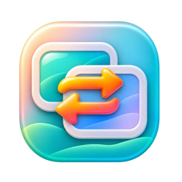
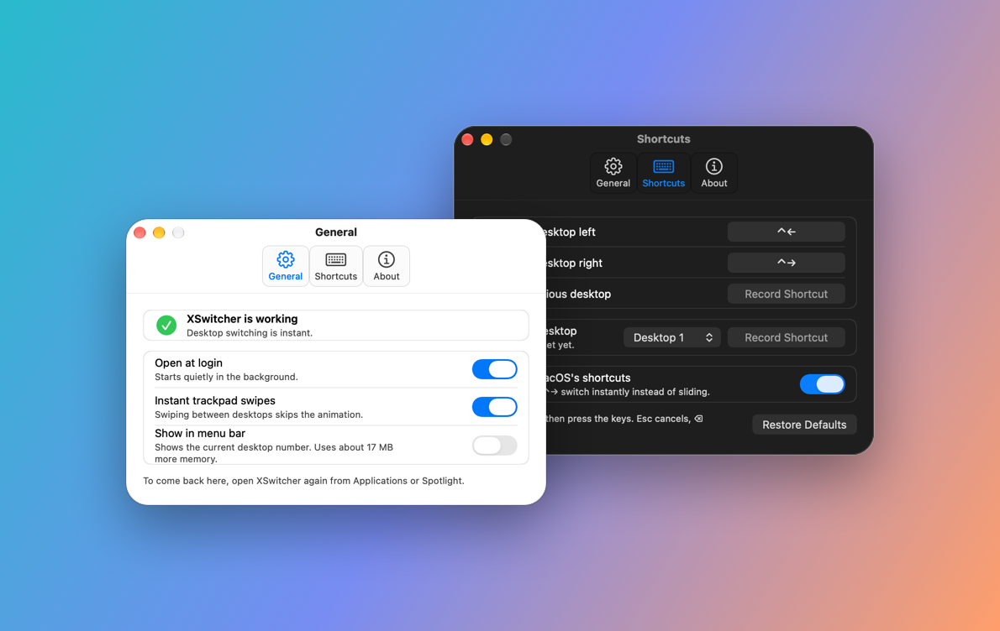
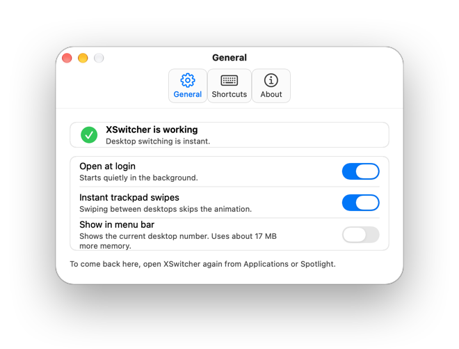
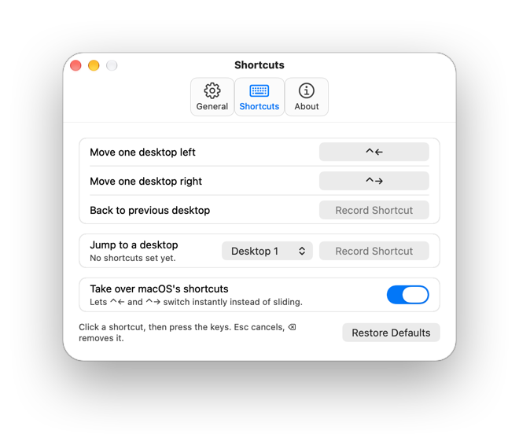
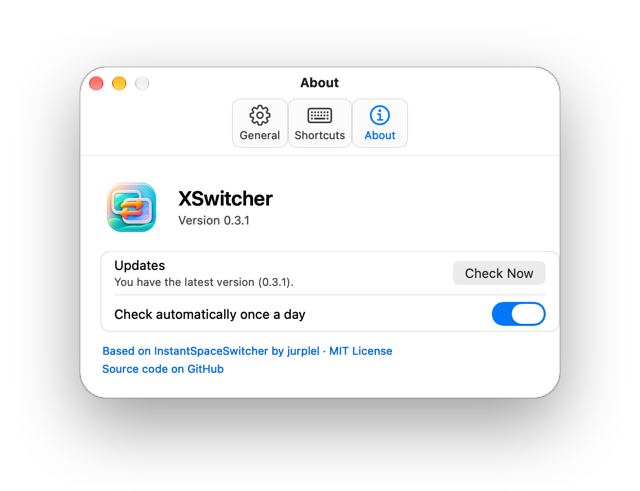
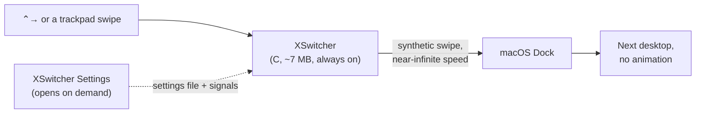

<p align="center">
  
</p>

<h1 align="center">XSwitcher</h1>

<p align="center">
  <b>Switch macOS desktops instantly. No sliding animation.</b><br>
  From the keyboard or the trackpad, in an app that idles at about 7 MB.
</p>

<p align="center">
  <a href="https://github.com/xcrap/xswitcher/releases/latest"></a>
  
  
  
  <a href="LICENSE"></a>
</p>

<p align="center">
  <a href="https://github.com/xcrap/xswitcher/releases/latest"><b>Download</b></a> ·
  <a href="#install">Install</a> ·
  <a href="#how-it-works">How it works</a> ·
  <a href="#credits">Credits</a>
</p>

<p align="center">
  
</p>

> [!NOTE]
> XSwitcher is based on [InstantSpaceSwitcher](https://github.com/jurplel/InstantSpaceSwitcher)
> by **jurplel**. The trick that skips the animation is jurplel's work. Thank you!

## Why

Every time you change desktops, macOS slides the whole screen sideways. It
takes long enough to break your flow, and it takes even longer on
high-refresh-rate displays. XSwitcher makes the switch instant, so the next
desktop is just *there*.

## Features

- ⚡ **Instant Ctrl+← / Ctrl+→.** It takes over macOS's own shortcuts, so
  there's nothing to change in System Settings.
- 🖐️ **Instant trackpad swipes.** Swipe between desktops with no animation.
- 🔢 **Jump straight to a desktop** (1–16), or back to the previous one.
- 🪶 **Featherweight:** about 7 MB of memory, 0% CPU and zero wake-ups while it
  waits for you.
- 🔐 **One app, one permission:** a single "XSwitcher" entry in Accessibility
  and in Login Items. Signed and notarized by Apple.
- 🔄 **Update checker** that looks for new releases here once a day.
- 🌗 **Settings that get out of the way:** the window closes completely, and
  the menu bar icon is optional.

## Screenshots

<table>
  <tr>
    <th>General</th>
    <th>Shortcuts</th>
    <th>About</th>
  </tr>
  <tr>
    <td><picture><source media="(prefers-color-scheme: dark)" srcset="docs/general-dark.png"></picture></td>
    <td><picture><source media="(prefers-color-scheme: dark)" srcset="docs/shortcuts-dark.png"></picture></td>
    <td><picture><source media="(prefers-color-scheme: dark)" srcset="docs/about-dark.png"></picture></td>
  </tr>
</table>

## By the numbers

Measured on macOS 27 (Apple silicon) with XSwitcher running in the background:

| | XSwitcher |
|---|---|
| Memory while running | **~7 MB** (the menu bar icon adds ~17 MB if you turn it on) |
| CPU while waiting | **0%** (0.23 s of CPU in 5½ minutes, mostly at startup) |
| Wake-ups while idle | **0 per second**: it sleeps until you press a shortcut or swipe |
| Work per shortcut | **~0.2 ms**, then macOS does the switch |
| App size | **880 KB**, a ~290 KB download, Apple silicon and Intel |

For comparison, a minimal Swift menu bar app starts at about 15 MB. The
switch itself takes the same time in any app like this, because the Dock does
it. XSwitcher's advantage is how little it costs the rest of the time.

## Install

1. Download the **XSwitcher** zip from the
   [latest release](https://github.com/xcrap/xswitcher/releases/latest),
   unzip it, and move **XSwitcher** to Applications.
2. Open it. The Settings window appears.
3. Click **Allow…** and turn on **XSwitcher** under
   Privacy & Security › Accessibility.
4. Turn on **Open at login**, then press **Ctrl+→**.

To get back to Settings later, open XSwitcher again from Applications or
Spotlight.

> [!TIP]
> Using the trackpad? Turn on **Instant trackpad swipes** in Settings. On
> macOS 27.2 and later, the trackpad's "swipe between full-screen apps"
> gesture must also be on, and Settings warns you if it isn't.

### Shortcuts

| Action | Default |
|---|---|
| Move one desktop left / right | **⌃←** / **⌃→** |
| Back to the previous desktop | not set |
| Jump to desktop 1–16 | not set |

Click a shortcut in Settings, then press the keys. **Esc** cancels and
**Delete** removes it. macOS keeps ⌃← / ⌃→ to itself while you record, so
**Restore Defaults** sets those.

## How it works

macOS has no setting to turn the desktop animation off. But when you swipe
between desktops on a trackpad, the Dock animates at the speed of your
fingers. XSwitcher sends the Dock a synthetic swipe that is so fast the
animation is over before it starts.



XSwitcher.app has two parts:

- **The switcher** (C, `Contents/MacOS/xswitcher-agent`) is the app's main
  program. It listens for your shortcuts and swipes, takes over Ctrl+arrows
  before macOS sees them, and never loads AppKit. It also answers Finder and
  Spotlight, so opening XSwitcher opens Settings.
- **XSwitcher Settings** (Swift/AppKit, in `Contents/Helpers`) is the Settings
  window and the optional menu bar icon. It needs no permission of its own,
  and it quits when you close the window.

They share a plain text file, `~/.config/xswitcher/config`, which you can also
edit by hand. After editing, reload with `kill -HUP $(pgrep -x xswitcher-agent)`.

## Compared with InstantSpaceSwitcher

| | InstantSpaceSwitcher 3.1 | XSwitcher |
|---|---|---|
| Memory while running | 15 MB or more | **~7 MB** |
| Menu bar icon | always on | optional |
| Ctrl+← / Ctrl+→ | turn off macOS's shortcuts first ([#46](https://github.com/jurplel/InstantSpaceSwitcher/issues/46)) | **taken over directly** |
| Update checker | planned ([#1](https://github.com/jurplel/InstantSpaceSwitcher/issues/1)) | built in |
| Trackpad gesture off on macOS 27.2 | stops working silently ([#114](https://github.com/jurplel/InstantSpaceSwitcher/issues/114)) | warns you, with a fix button |
| Settings window | stays in memory once opened | closes completely |
| On-screen desktop number | yes | not yet |
| Animation speed choices | yes, on macOS 26 and earlier | config file only |

## Build from source

```sh
git clone https://github.com/xcrap/xswitcher
cd xswitcher
make install        # builds XSwitcher.app and copies it to /Applications
```

Needs the Xcode command line tools. Without a certificate the app is signed
ad hoc, and macOS asks for the Accessibility permission again after every
rebuild. To keep it, put your certificate in a git-ignored `local.mk`:

```make
SIGN_ID = Developer ID Application: Your Name (TEAMID)
```

<details>
<summary><b>Notarizing a release</b></summary>

With a Developer ID certificate, `make notarize` sends the app to Apple,
staples the approval ticket and writes `build/XSwitcher-<version>.zip`, ready
to attach to a GitHub release. Save your Apple login once first:

```sh
xcrun notarytool store-credentials xswitcher-notary --team-id <TEAMID>
```

It asks for your Apple ID and an app-specific password (account.apple.com ›
Sign-In and Security › App-Specific Passwords). Your developer account must
have accepted Apple's latest agreement at developer.apple.com/account.

The update checker reads releases from the repo set by `UPDATE_REPO` in the
Makefile; tag releases with the version number, e.g. `v0.3.1`.
</details>

<details>
<summary><b>Project layout</b></summary>

```
agent/    the switcher, XSwitcher.app's main program (C)
app/      XSwitcher Settings: Settings window and menu bar icon (Swift/AppKit)
bundle/   Info.plist files and the app icon
docs/     README images
Makefile  make, make install, make notarize, make clean
```
</details>

## Known limits

- Dragging a window while switching doesn't carry it along (same as upstream
  [#29](https://github.com/jurplel/InstantSpaceSwitcher/issues/29)).
- Shortcuts act on the display under the mouse pointer. "Back to the previous
  desktop" remembers one display at a time.
- With instant swipes on, swiping while Mission Control is open may switch
  desktops instead.

## Credits

XSwitcher is based on
[InstantSpaceSwitcher](https://github.com/jurplel/InstantSpaceSwitcher) by
**jurplel**, MIT License. The synthetic-swipe technique, including the macOS 27
event format, is jurplel's work, ported to C here.

## License

MIT. Copyright (c) 2026 jurplel for the original InstantSpaceSwitcher code;
see [LICENSE](LICENSE).
